  

[Русский](./README.md) · **English**

Moscow, hybrid or remote · MTUCI, 09.03.02 “DevSecOps”, 1st year · English B2

## About

I ship services to production myself and keep them running: deploys, alerts, dashboards, backups. My production runs on Docker Compose: SolMeme has been live for about a year, SolPump is in beta with full monitoring. I was the tech lead of a 4-person team that built a study observability and self-healing setup on Kubernetes. Looking for an internship or a junior DevOps / SRE role.

I also write the code myself: fullstack with Vue 3, NestJS, TypeScript and Python. SolMeme, SolPump and PolyX are mine end to end: website, backend, bots, deploys.

| ~1 year | 14 + 6 | 2nd place | Finalist |
|:---:|:---:|:---:|:---:|
| SolMeme in production, server and deploys on me | alert rules and dashboards in SolPump | “Telecom of the Future 2026”, MTS case, tech lead | PROD 2026, 65/100 |

## Stack

| Area | Tools |
|---|---|
| **CI/CD and servers** | GitHub Actions, Docker Compose, Nginx, systemd, Ansible, Linux |
| **Observability** | Prometheus, Alertmanager, Grafana, Loki, Alloy, Tempo, Blackbox, Sentry |
| **Kubernetes** | k3s (k3d), Helm, Istio, Chaos Mesh — study setup |
| **Load and tests** | k6, pytest, Jest |
| **Languages** | TypeScript, Python — confident; Go — basic |
| **Data** | PostgreSQL, MongoDB, Redis, ClickHouse |

## Projects

### SolMeme and SolPump

[sol-meme.com](https://sol-meme.com) · [solpump.gg](https://solpump.gg) (beta) · from scratch, solo, ~1 year in production

Anyone can launch their own Solana token in a couple of minutes: upload an image, confirm in the wallet and get a token, a trading pool and a referral link. SolPump grew out of it: short-term bets on whether a meme token’s price goes up or down.

- **One-year result:** users created 619 tokens and 459 pools, the service earned 321 SOL in token-burn fees.
- **Operations:** solely responsible for running the services: server, Nginx, Docker, deploys, monitoring, backups.
- **CI/CD:** GitHub Actions lints, runs tests, builds images and deploys over SSH only from `main` and only when everything is green. Daily database backup, 7 copies kept.
- **SolPump monitoring:** 14 alert rules and 6 dashboards: business metrics, HTTP, backend, host, containers, Prometheus itself. Job queues export metrics too. Errors go to Sentry, logs to Loki.
- **Alerts that matter:** fire if any withdrawal fails, the price stops updating or the fee balance goes negative.

`Docker Compose` `Nginx` `GitHub Actions` `Prometheus` `Grafana` `Loki` `Sentry` `NestJS` `MongoDB` `PostgreSQL` `Redis`

### MTC SRE

[github.com/spasster/MTC-SRE](https://github.com/spasster/MTC-SRE) · “Telecom of the Future 2026” hackathon, MTS case #2, **2nd place** · team of 4, tech lead · study stand, not production

A demo shop: the checkout request stores the cart in Redis and calls a payment service. The platform detects slow requests and 5xx errors, correlates metric, trace and log, and brings the service back to normal without taking dangerous actions blindly.

- **My part:** architecture, SLOs, self-healing thresholds and limits, technical review.
- **SLO:** at least 99.5% successful requests, p95 under 300 ms, Redis and payment alive per Blackbox probes. Separate error-budget burn rules.
- **Self-healing:** automatic after a dry run: remove a pod at least 3× slower than the rest, scale checkout from 2 to 5 replicas when all are CPU-bound. Release rollback and Redis restart only via a Telegram button. At most 2 actions per incident.
- **In numbers:** 12 Prometheus rules, 5 Grafana dashboards, 7 runbooks, 276 pytest tests, 6 chaos scenarios, full e2e on clean Ubuntu.

`k3s` `Helm` `Istio mTLS` `Chaos Mesh` `Prometheus` `Alertmanager` `Grafana` `Loki` `Tempo` `Blackbox` `Ansible` `k6` `Python`

### Lotty

[github.com/spasster/lotty-ab-platform](https://github.com/spasster/lotty-ab-platform) · A/B testing platform, PROD 2026 finals · backend and infrastructure, solo

An internal service for teams: roll features out to a share of users, compare variants, view reports and automatically stop an experiment when a key metric drops.

- **Infrastructure and observability:** Docker Compose, 15 Prometheus metrics, 5 Grafana dashboards, structured logs, C4 diagrams and a runbook.
- **CI:** lint, tests with coverage, build, e2e against real MongoDB, Redis and ClickHouse, image builds, smoke check after compose up.
- **Load:** k6, 50 users, 30 seconds, target under 1% errors and p95 under 2 s. Quick post-deploy test: health, ready, login, decide, events.

`NestJS` `MongoDB` `ClickHouse` `Redis` `Docker Compose` `Prometheus` `Grafana` `k6` `Jest`

### PolyX

[@polyxcopy_bot](https://t.me/polyxcopy_bot) · Polymarket copy-trading · in production since May 2026 · I’m the developer, a partner owns the product

- Website, bot, background workers, wallets, deposits and server setup.
- Bot and API run as systemd services, the website runs in Docker via Compose.

`Python` `aiogram` `Nuxt 4` `PostgreSQL` `systemd` `Docker`

## Contests and hackathons

| Where | Result |
|---|---|
| **“Telecom of the Future 2026”** (MTUCI) | 2nd place, MTS case #2 “SRE observability platform”. MTC SRE project, tech lead |
| **PROD 2026** | Finalist, individual stage 65/100. Final case — Lotty |
| **Technostrelka 2025** | 1st place, Neymark case: a platform for student dormitories |
| **Hackathons in Ryazan** | 2nd and 3rd place |
| **IT-Quantum** | Telegram bots, computer vision, an Android app for transit payments |

---

**[Download CV (PDF)](./Nelin-Danila-DevOps-CV-EN.pdf)** · [Telegram](https://t.me/spaster) · [nelindanila7@gmail.com](mailto:nelindanila7@gmail.com)

