  

**Русский** · [English](./README.en.md)

Москва, гибрид или удалёнка · МТУСИ, 09.03.02 «DevSecOps», 1 курс · английский B2

## Коротко

Сам запускаю сервисы в прод и слежу, чтобы они работали: выкладка, алерты, дашборды, бэкапы. Прод у меня на Docker Compose: SolMeme работает около года, SolPump в бета-тесте с мониторингом. В команде из 4 человек был техлидом учебного контура наблюдаемости в Kubernetes. Ищу стажировку или junior-позицию DevOps / SRE.

Код тоже пишу сам: фуллстак на Vue 3, NestJS, TypeScript и Python. SolMeme, SolPump и PolyX сделаны мной целиком — сайт, бэкенд, боты, выкладка.

| ~1 год | 14 + 6 | 2 место | Финал |
|:---:|:---:|:---:|:---:|
| SolMeme в проде, сервер и выкладка на мне | алертов и дашбордов в SolPump | «Телеком будущего 2026», кейс МТС, я техлид | PROD 2026, 65/100 |

## Стек

| Направление | Инструменты |
|---|---|
| **CI/CD и серверы** | GitHub Actions, Docker Compose, Nginx, systemd, Ansible, Linux |
| **Наблюдаемость** | Prometheus, Alertmanager, Grafana, Loki, Alloy, Tempo, Blackbox, Sentry |
| **Kubernetes** | k3s (k3d), Helm, Istio, Chaos Mesh — учебный контур |
| **Нагрузка и тесты** | k6, pytest, Jest |
| **Языки** | TypeScript, Python — уверенно; Go — начальный |
| **Данные** | PostgreSQL, MongoDB, Redis, ClickHouse |

## Проекты

### SolMeme и SolPump

[sol-meme.com](https://sol-meme.com) · [solpump.gg](https://solpump.gg) (бета-тест) · с нуля, один, около года в проде

Сервис, где любой человек за пару минут выпускает свой токен на Solana: загружает картинку, подтверждает в кошельке и получает токен, торговый пул и реферальную ссылку. Из него вырос SolPump: ставки на рост или падение цены мем-токена за короткое время.

- **Результат за год:** пользователи создали 619 токенов и 459 пулов, сервис заработал 321 SOL на комиссии за сжигание токенов.
- **Эксплуатация:** один отвечал за запуск и работу сервисов: сервер, Nginx, Docker, выкладка, наблюдение, резервные копии.
- **CI/CD:** GitHub Actions проверяет код, гоняет тесты, собирает образы и выкатывает по SSH только из `main` и только если всё зелёное. Ежедневный бэкап базы, 7 копий.
- **Мониторинг SolPump:** 14 правил алертов и 6 дашбордов: бизнес-цифры, HTTP, backend, сервер, контейнеры, сам Prometheus. Очереди задач тоже отдают метрики. Ошибки собирает Sentry, логи — Loki.
- **Алерты по делу:** срабатывают, если упал любой вывод средств, цена перестала обновляться или баланс на комиссии ушёл в минус.

`Docker Compose` `Nginx` `GitHub Actions` `Prometheus` `Grafana` `Loki` `Sentry` `NestJS` `MongoDB` `PostgreSQL` `Redis`

### MTC SRE

[github.com/spasster/MTC-SRE](https://github.com/spasster/MTC-SRE) · хакатон «Телеком будущего 2026», кейс МТС №2, **2 место** · команда из 4, я техлид · учебный стенд, не прод

Учебный магазин: запрос checkout кладёт корзину в Redis и вызывает сервис оплаты. Платформа замечает медленные запросы и ошибки 5xx, связывает метрику, трассу и лог и возвращает сервис в норму, не делая опасных действий вслепую.

- **Моя часть:** архитектура, SLO, пороги и границы автолечения, техническое ревью.
- **SLO:** не меньше 99,5% успешных запросов, p95 ниже 300 мс, живые Redis и сервис оплаты по проверке Blackbox. Отдельные правила на расход бюджета ошибок.
- **Автолечение:** само, после dry-run: убрать под, который минимум в 3 раза медленнее остальных, и поднять checkout с 2 до 5 реплик, если все упёрлись в CPU. Откат релиза и рестарт Redis — только по кнопке в Telegram. Не больше 2 действий за инцидент.
- **В цифрах:** 12 правил Prometheus, 5 дашбордов Grafana, 7 runbook, 276 тестов pytest, 6 хаос-сценариев, полный e2e на чистом Ubuntu.

`k3s` `Helm` `Istio mTLS` `Chaos Mesh` `Prometheus` `Alertmanager` `Grafana` `Loki` `Tempo` `Blackbox` `Ansible` `k6` `Python`

### Lotty

[github.com/spasster/lotty-ab-platform](https://github.com/spasster/lotty-ab-platform) · платформа A/B-тестов, финал PROD 2026 · бэкенд и инфраструктура, один

Внутренний сервис для команд: включать функции для части пользователей, сравнивать варианты, смотреть отчёты и автоматически останавливать эксперимент, если ключевая метрика падает.

- **Инфраструктура и наблюдаемость:** Docker Compose, 15 метрик Prometheus, 5 дашбордов Grafana, структурные логи, схемы C4 и runbook.
- **CI:** lint, тесты с покрытием, сборка, e2e на настоящих MongoDB, Redis и ClickHouse, сборка образов, smoke-проверка после запуска compose.
- **Нагрузка:** k6, 50 пользователей, 30 секунд, цель — ошибок меньше 1% и p95 меньше 2 с. После выкладки быстрый тест: health, ready, вход, запрос, события.

`NestJS` `MongoDB` `ClickHouse` `Redis` `Docker Compose` `Prometheus` `Grafana` `k6` `Jest`

### PolyX

[@polyxcopy_bot](https://t.me/polyxcopy_bot) · копирование сделок трейдеров Polymarket · в проде с мая 2026 · я разработчик, продукт ведёт партнёр

- Сайт, бот, фоновые процессы, кошельки, пополнение и запуск на сервере.
- Бот и API работают как сервисы systemd, сайт — в Docker через Compose.

`Python` `aiogram` `Nuxt 4` `PostgreSQL` `systemd` `Docker`

## Олимпиады и хакатоны

| Где | Результат |
|---|---|
| **«Телеком будущего 2026»** (МТУСИ) | 2 место, кейс МТС №2 «SRE-платформа наблюдаемости». Проект MTC SRE, я техлид |
| **PROD 2026** | Финалист, индивидуальный этап 65/100. Кейс финала — Lotty |
| **Технострелка 2025** | 1 место, кейс от Неймарк: платформа для общежитий |
| **Хакатоны в Рязани** | 2 и 3 место |
| **IT-квантум** | Telegram-боты, компьютерное зрение, Android-приложение для оплаты проезда |

---

**[Скачать резюме (PDF)](./Nelin-Danila-DevOps-CV.pdf)** · [Telegram](https://t.me/spaster) · [nelindanila7@gmail.com](mailto:nelindanila7@gmail.com)

